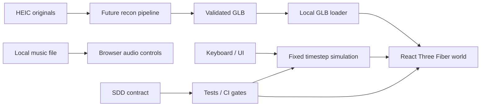

# Architecture / system boundaries

## Current M0
Browser-only React + Vite + React Three Fiber + Three.js, TypeScript. `src/sim/vehicle.ts` exposes pure kinematic stepping; `src/world/World.tsx` renders the procedural world and applies a fixed 1/60 s update; UI controls are DOM with keyboard input captured in a hook.

Rendering and physics must remain distinct; avoid React state per animation frame. Numerical simulations tested without WebGL; rendering reviewed in browser.

## Coordinate model
Right-handed: Y up; forward = negative Z at heading 0, X right. Distances m, time s, angles rad, speed m/s. Spawn at (0,0), heading 0. One road lane width 3.5m; initial road is stylized, not georeferenced.

Parent-measured truck: body length 10.4cm excluding front bumper; width 3.1cm, front highest point 4.7cm, tire diameter 1.4cm. All dimensions scale uniformly from the 2.50m target game width (×80.645), yielding body length 8.387m, front peak 3.790m, tires 1.129m. Imported GLBs are width-calibrated from bounding-box X dimension to 2.50m with isotropic scale, not longest-dimension normalization. Primary forward (-Z) and up (+Y) must be verified; bbox width can include mirrors or outboard wheels, so parent calibration remains provisional. Wheel collisions and bumper front overhang now measured at 0.8cm toy / 0.645m game; axle centerlines 2.4/5.6/7.2/8.8cm from body front, leaving 1.6cm at the back. The four-axle layout is measured longitudinally, but tire lateral offsets/steering axle choice are not inferred from mesh; world vehicle bounding volume is distinct.

## Interactive drivetrain slice (007 — arcade-level, 2026-10-17)
- `src/sim/drivetrain.ts`: immutable 8×4/8×8 and 3-lock controller; pure traction proxy on paved/low-grip example surfaces; both front axle angles independently represented.
- `src/sim/vehicle.ts`: deterministic kinematic bicycle approximation keeps previous API; applies bounded low-grip coefficient, double-front-axle weighted steering angle, no force/contact solver.
- `src/world/World.tsx`: 14 rendered tires, measured longitudinal stations, first two wheels steer visually; Three.js -Y yaw sign corrected for logical +X-right steering. Exposed tractor rear chassis, not a rectangular cargo container.
- `src/App.tsx`: right-side accessible drivetrain controls, Q/1/2/3/T shortcuts, persistent *in-session* selected mode after vehicle reset.
- Explicit limitations: low-grip is a simulation toggle, not physically modeled 3D terrain; locks are logical, imported custom GLBs do not yet rig wheels; collision / torque / suspension / tire patch loads remain M2 physics.

## Future domain modules
- asset-ingestion: HEIC handling, camera calibration, model reconstruction runs offline/explicit provider opt-in only; provenance in manifest.
- asset-validation: mesh scale, pivot, axis, GLB validity and budgets, author consent.
- garage-persistence: local IndexedDB initially, explicit opt-in cloud only if necessary.
- physics: Rapier bodies/wheels/contacts, stable substeps and safe fallback.
- world streaming: indexed chunks, road graph/terrain, LOD, daylight and attribution.
- audio: user local BGM with persistence of preferences but not files unless approved.

## Non-functional design constraints
Render 60 Hz target, physics fixed 60 Hz; cap per-frame catch-up. Mobile optimization later. No service/backend for M0, no telemetry and no remote asset service. Use environment-independent deterministic tests. If imported WebGL scene fails, UI should present a friendly message.

## Upstream project references
- Spec process: https://github.com/github/spec-kit ; https://openspec.dev/docs/schemas/spec-driven
- Rendering/perf: https://docs.pmnd.rs/react-three-fiber/advanced/scaling-performance
- Physics candidate: https://github.com/pmndrs/react-three-rapier
- GLB: https://threejs.org/docs/pages/GLTFLoader
- Browser CI: https://playwright.dev/docs/ci
- Parts: https://threejs.org/docs/pages/LDrawLoader

Adopt conceptual patterns; do not copy dependencies, licensed models, or entire framework scaffolds blindly.
