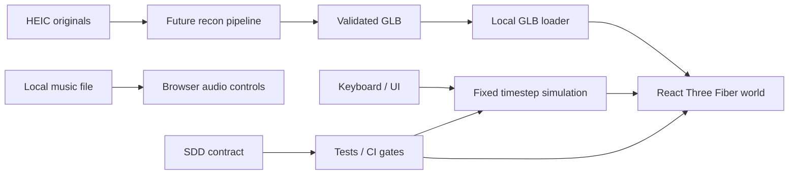

# Architecture / system boundaries

## Current M0
Browser-only React + Vite + React Three Fiber + Three.js, TypeScript. `src/sim/vehicle.ts` exposes pure kinematic stepping; `src/world/World.tsx` renders the procedural world and applies a fixed 1/60 s update; UI controls are DOM with keyboard input captured in a hook.

Rendering and physics must remain distinct; avoid React state per animation frame. Numerical simulations tested without WebGL; rendering reviewed in browser.

## Coordinate model
Right-handed: Y up; forward = negative Z at heading 0, X right. Distances m, time s, angles rad, speed m/s. Spawn at (0,0), heading 0. One road lane width 3.5m; initial road is stylized, not georeferenced.

Imported models retain aspect ratio, fit uniform display bounding box (maximum horizontal dimension approximately 3.6m); their primary forward direction must be declared/verified. Wheel collisions not inferred from mesh. World vehicle bounding volume is separate from visual mesh.

## Future domain modules
- asset-ingestion: HEIC handling, camera calibration, model reconstruction runs offline/explicit provider opt-in only; provenance in manifest.
- asset-validation: mesh scale, pivot, axis, GLB validity and budgets, author consent.
- garage-persistence: local IndexedDB initially, explicit opt-in cloud only if necessary.
- physics: Rapier bodies/wheels/contacts, stable substeps and safe fallback.
- world streaming: indexed chunks, road graph/terrain, LOD, daylight and attribution.
- audio: user local BGM with persistence of preferences but not files unless approved.

## Non-functional design constraints
Render 60 Hz target, physics fixed 60 Hz; cap per-frame catch-up. Mobile optimization later. No service/backend for M0, no telemetry and no remote asset service. Use environment-independent deterministic tests. If imported WebGL scene fails, UI should present a friendly message.

## Upstream project references
- Spec process: https://github.com/github/spec-kit ; https://openspec.dev/docs/schemas/spec-driven
- Rendering/perf: https://docs.pmnd.rs/react-three-fiber/advanced/scaling-performance
- Physics candidate: https://github.com/pmndrs/react-three-rapier
- GLB: https://threejs.org/docs/pages/GLTFLoader
- Browser CI: https://playwright.dev/docs/ci
- Parts: https://threejs.org/docs/pages/LDrawLoader

Adopt conceptual patterns; do not copy dependencies, licensed models, or entire framework scaffolds blindly.
